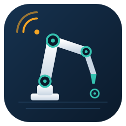
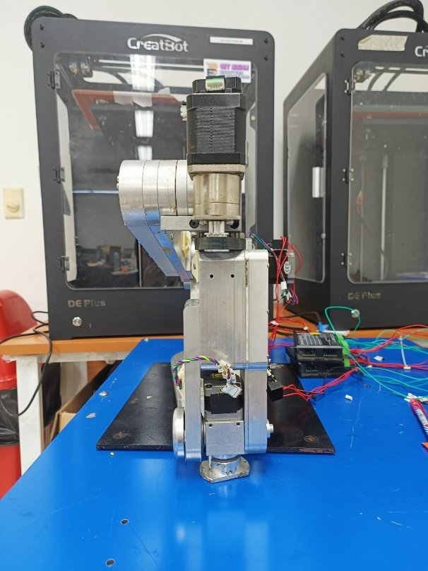
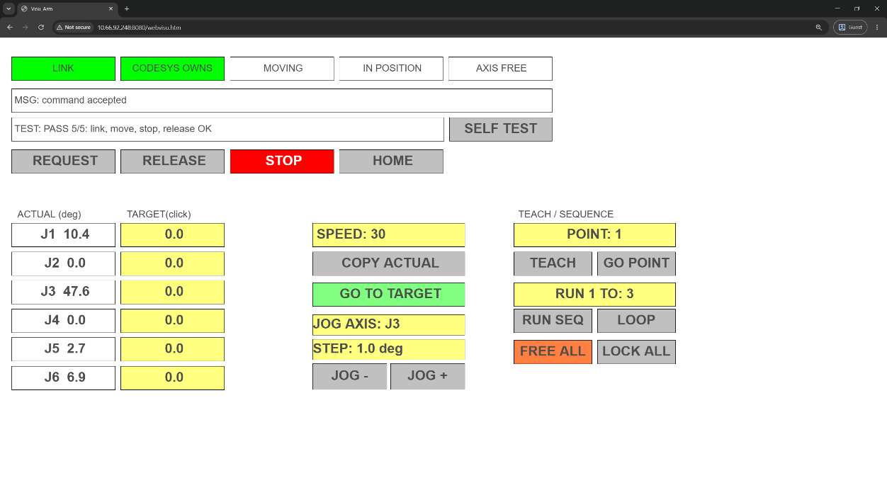
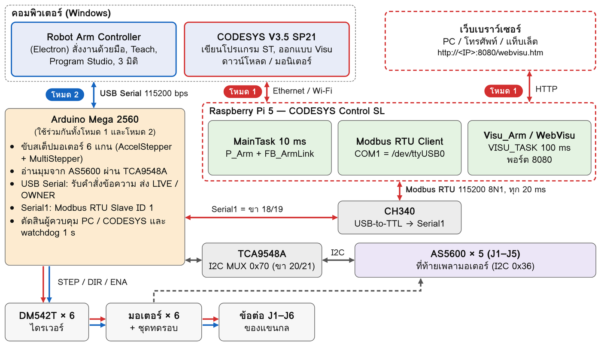
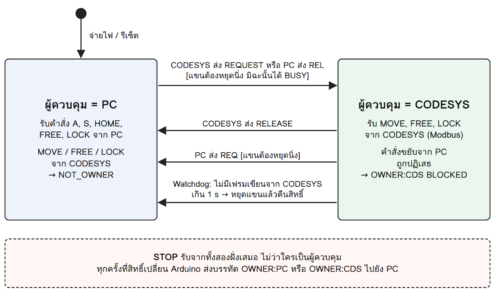
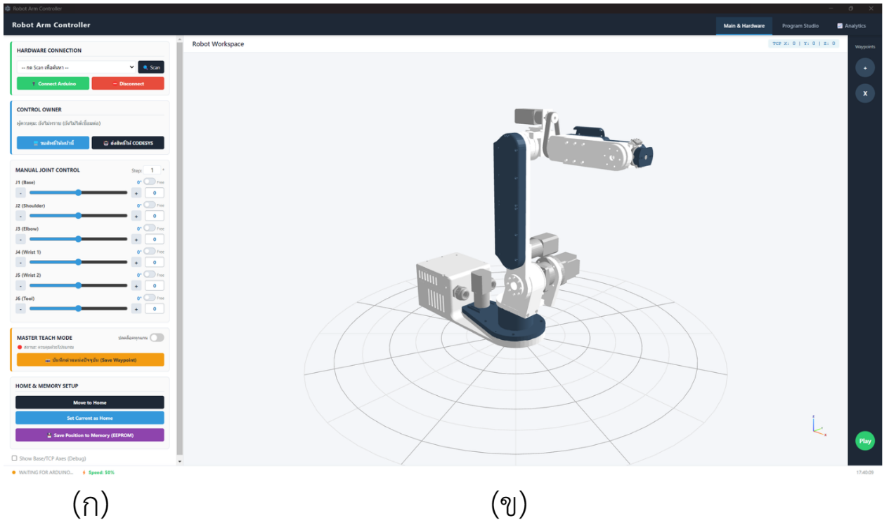
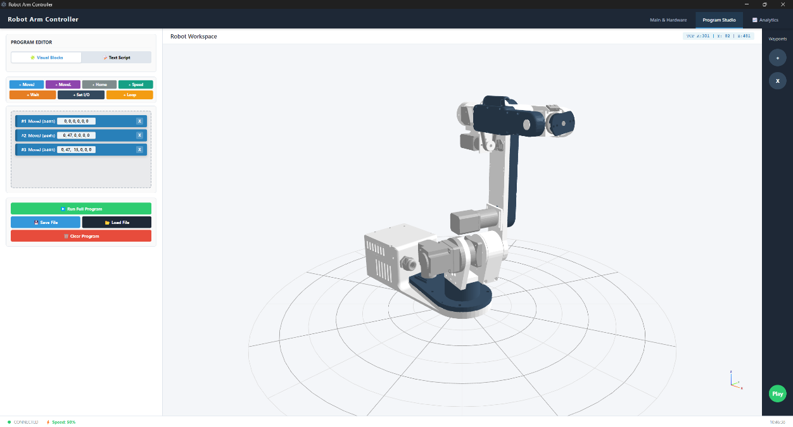
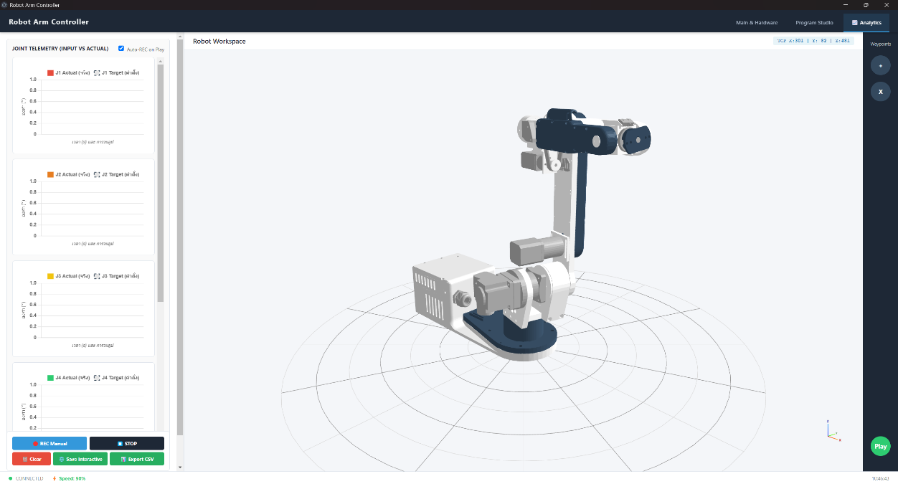
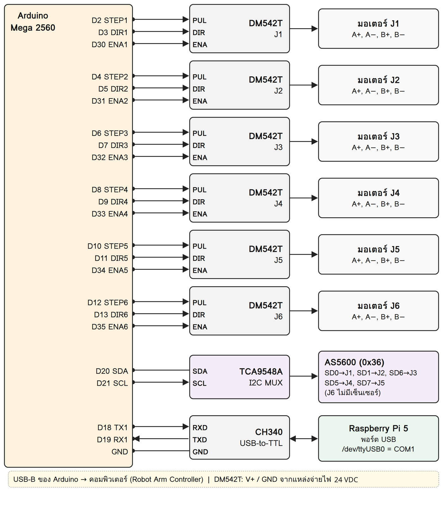
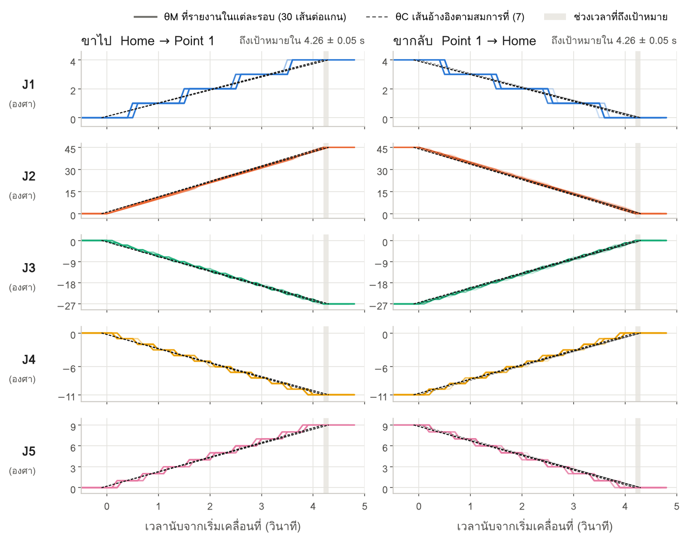

<p align="center">
  
</p>

<h1 align="center">SoftPLC-RaspberryPi5-CODESYS-Control</h1>

<p align="center">
  ระบบควบคุมเชิงตำแหน่งสำหรับแขนกล 6 แกนด้วย CODESYS บน Raspberry Pi 5<br>
  <i>6-DOF Robotic Arm Position Control with CODESYS Soft-PLC on Raspberry Pi 5</i>
</p>

<p align="center">
  
  
  
  
  
</p>

---

## สารบัญ

- [ภาพรวม](#ภาพรวม)
- [สถาปัตยกรรมของระบบ](#สถาปัตยกรรมของระบบ)
- [โครงสร้างไฟล์](#โครงสร้างไฟล์)
- [อุปกรณ์ที่ใช้](#อุปกรณ์ที่ใช้)
- [การติดตั้ง](#การติดตั้ง)
- [วิธีใช้งาน](#วิธีใช้งาน)
- [ข้อควรระวังและการแก้ปัญหา](#ข้อควรระวังและการแก้ปัญหา)
- [ข้อมูลทางเทคนิค](#ข้อมูลทางเทคนิค)
- [ที่มาและเครดิต](#ที่มาและเครดิต)

---

## ภาพรวม

โปรเจกต์นี้พัฒนาระบบควบคุมการเคลื่อนที่เชิงตำแหน่งของแขนกล 6 แกน โดยใช้ **Raspberry Pi 5** เป็นพีแอลซีแบบซอฟต์แวร์ (**Soft-PLC**) ที่รัน **CODESYS** ตามมาตรฐาน **IEC 61131-3** และสื่อสารผ่าน **Modbus RTU** ไปยัง **Arduino Mega 2560** ซึ่งสร้างพัลส์ขับสเต็ปปิ้งมอเตอร์ทั้ง 6 แกน และอ่านมุมจากเซนเซอร์แม่เหล็ก **AS5600**

ระบบสั่งงานได้ 2 โหมด และสลับกันได้ โดยมีผู้ควบคุมได้ครั้งละหนึ่งฝั่ง

| โหมด | สั่งงานผ่าน | เส้นทางคำสั่ง |
|---|---|---|
| **CODESYS** (โหมดหลัก) | หน้าจอ `Visu_Arm` บนเว็บเบราว์เซอร์ (WebVisu) | Browser → Raspberry Pi 5 (CODESYS) → Modbus RTU → Arduino |
| **Arduino** | โปรแกรม **Robot Arm Controller** บนคอมพิวเตอร์ | PC → USB Serial → Arduino |

<p align="center">
  
  &nbsp;
  
</p>

---

## สถาปัตยกรรมของระบบ

<p align="center"></p>

1. **Raspberry Pi 5 — Soft-PLC (ตัวควบคุมระดับบน)**
   - รันไทม์ `CODESYS Control for Raspberry Pi 64 SL`
   - `MainTask` ทุก 10 ms และ `VISU_TASK` ทุก 100 ms
   - เป็น **Modbus RTU Client** ส่งรหัสคำสั่ง มุมเป้าหมาย และความเร็วผ่านตัวแปลง `CH340` ทุก 20 ms
   - ให้บริการหน้าจอ **WebVisu** ที่พอร์ต `8080`
2. **Arduino Mega 2560 — Motion Controller**
   - เป็น **Modbus RTU Slave (ID 1)** บน `Serial1` (115,200 bps, 8N1) และรับคำสั่งข้อความผ่าน USB Serial จากคอมพิวเตอร์
   - ขับไดรเวอร์ **DM542T** ทั้ง 6 แกนด้วย `AccelStepper` / `MultiStepper` ให้ทุกแกนเริ่มและถึงเป้าหมายพร้อมกัน
   - อ่านมุมเพลามอเตอร์ J1–J5 จาก **AS5600** ผ่าน I2C Multiplexer **TCA9548A**
   - จัดการสิทธิ์ผู้ควบคุม (PC หรือ CODESYS) พร้อม **Watchdog 1 วินาที** และคำสั่ง `STOP` ที่รับได้จากทุกฝั่ง
3. **Robot Arm Controller — โปรแกรมบนคอมพิวเตอร์**
   - พัฒนาด้วย Electron (HTML, CSS, JavaScript) แสดงแบบจำลอง 3 มิติด้วย `three.js`
   - Manual Joint Control, Master Teach, Program Studio (`MoveJ`, `MoveL`, `Loop`) และ Analytics บันทึกมุมสั่งเทียบมุมจริงเป็น CSV

<details>
<summary><b>แผนภาพการสลับสิทธิ์ผู้ควบคุม</b></summary>
<p align="center"></p>
</details>

---

## โครงสร้างไฟล์

```text
SoftPLC-RaspberryPi5-CODESYS-Control/
├── CODESYS/
│   ├── 1_GVL_ARM.txt              ตัวแปรส่วนกลาง (แมปรีจิสเตอร์ Modbus, มุม, จุด Teach 20 จุด)
│   ├── 2a_FB_ArmLink_TOP.txt      ส่วนประกาศตัวแปรของ FB_ArmLink
│   ├── 2b_FB_ArmLink_BOTTOM.txt   ลอจิก FB_ArmLink (สถานะลิงก์, แปลงค่า, CMD_SEQ / ACK_SEQ)
│   ├── 3a_P_Arm_TOP.txt           ส่วนประกาศตัวแปรของโปรแกรมหลัก P_Arm
│   └── 3b_P_Arm_BOTTOM.txt        ลอจิก P_Arm (Manual, Teach, RUN SEQ / LOOP, xInPos)
├── Arduino_Controller_CODESYS/
│   ├── Arduino_Controller_CODESYS.ino   เฟิร์มแวร์หลัก (มอเตอร์, AS5600, EEPROM, USB Serial)
│   ├── CodesysLink.h                    ค่าคงที่การสื่อสารกับ CODESYS
│   └── CodesysLink.ino                  Modbus RTU Slave, สิทธิ์ผู้ควบคุม, Watchdog
├── RobotArmController/            โปรแกรม Robot Arm Controller (Electron) สำหรับโหมด Arduino
│   ├── index.html                 หน้าจอและลอจิกทั้งหมดของโปรแกรม
│   ├── main.js                    หน้าต่าง Electron และการเลือกพอร์ต Serial
│   ├── meshes/                    โมเดล 3 มิติ (STL) ของแขนกล AR2
│   └── build/icon.ico             ไอคอนที่ใช้ตอน build
├── assets/                        ไอคอนโปรแกรม (SVG, PNG, ICO)
└── docs/images/                   ภาพประกอบ README
```

---

## อุปกรณ์ที่ใช้

| อุปกรณ์ | จำนวน | หน้าที่ |
|---|---|---|
| แขนกล 6 แกน (AR2) พร้อมสเต็ปปิ้งมอเตอร์ | 1 | ตัวแขนกล |
| ไดรเวอร์ DM542T | 6 | ขับมอเตอร์ตามสัญญาณ PUL / DIR / ENA |
| Arduino Mega 2560 | 1 | สร้างพัลส์ อ่านเซนเซอร์ และเป็น Modbus Slave |
| เซนเซอร์ AS5600 | 5 | วัดมุมเพลามอเตอร์ J1–J5 (J6 ไม่มีเซนเซอร์) |
| TCA9548A | 1 | แยกบัส I2C ของ AS5600 ที่มีแอดเดรสเดียวกัน |
| ตัวแปลง USB-to-TTL CH340 | 1 | เชื่อม Raspberry Pi 5 กับ `Serial1` ของ Arduino |
| Raspberry Pi 5 + อะแดปเตอร์ USB-C 5 V / 5 A | 1 | Soft-PLC และ WebVisu |
| คอมพิวเตอร์ Windows | 1 | CODESYS IDE และโปรแกรม Robot Arm Controller |

---

## การติดตั้ง

### 1) เฟิร์มแวร์ Arduino Mega 2560

1. ติดตั้ง **Arduino IDE** และไลบรารี `AccelStepper` (มี `MultiStepper` อยู่ในชุดเดียวกัน)
2. เปิดโฟลเดอร์ `Arduino_Controller_CODESYS/` (ชื่อโฟลเดอร์ต้องตรงกับไฟล์ `.ino` หลัก)
3. เลือกบอร์ด **Arduino Mega or Mega 2560** แล้วกด Upload

### 2) Raspberry Pi 5

1. ติดตั้งรันไทม์ **CODESYS Control for Raspberry Pi 64 SL** ผ่านเครื่องมือ **Deploy Control SL** ใน CODESYS
2. เสียบตัวแปลง `CH340` ที่พอร์ต USB ของ Pi (`/dev/ttyUSB0`) แล้วเพิ่มใน `/etc/codesyscontrol/CODESYSControl_User.cfg`

   ```ini
   [SysCom]
   Linux.Devicefile=/dev/ttyUSB
   ```
3. รีสตาร์ตรันไทม์ เพื่อให้พอร์ต `COM1` ในโปรเจกต์ชี้ไปที่ `/dev/ttyUSB0`

### 3) โปรเจกต์ CODESYS V3.5

1. สร้าง `GVL_ARM`, Function Block `FB_ArmLink` และโปรแกรม `P_Arm` แล้วคัดลอกโค้ดจากโฟลเดอร์ `CODESYS/` (ไฟล์ `TOP` = ส่วนประกาศตัวแปร, `BOTTOM` = ส่วนลอจิก)
2. เพิ่มอุปกรณ์ **Modbus COM** ที่ `COM1`, `115200`, `8N1`, Parity `NONE`
3. ตั้งค่า **Modbus Slave Channel**

   | ช่อง | Function Code | Offset | Length | Cyclic | แมปกับ |
   |---|---|---|---|---|---|
   | เขียน | 16 Write Multiple Registers | 0 | 10 | 20 ms | `GVL_ARM.awWr` |
   | อ่าน | 03 Read Holding Registers | 10 | 17 | 20 ms | `GVL_ARM.awRd` |
4. Login → Download → **Start**
5. เปิด `http://<IP ของ Raspberry Pi 5>:8080/webvisu.htm`

### 4) โปรแกรม Robot Arm Controller (Windows)

**แบบติดตั้ง** — ดาวน์โหลดไฟล์ `Robot Arm Controller Setup x.x.x.exe` จากหน้า [**Releases**](../../releases) แล้วติดตั้งตามขั้นตอน

**แบบรันจากซอร์สโค้ด** — ต้องมี [Node.js](https://nodejs.org/) (LTS)

```bash
cd RobotArmController
npm install        # ติดตั้ง Electron (ครั้งแรกครั้งเดียว)
npm start          # เปิดโปรแกรม  (หรือดับเบิลคลิก RobotControlAPP.bat)
npm run build      # สร้างไฟล์ติดตั้ง .exe ไว้ในโฟลเดอร์ release/
```

> [!NOTE]
> โปรแกรมโหลดไลบรารี three.js และ Chart.js จาก CDN จึงต้องต่ออินเทอร์เน็ตตอนเปิดโปรแกรม เพื่อให้ภาพ 3 มิติและกราฟแสดงผล

---

## วิธีใช้งาน

> [!IMPORTANT]
> **ตั้งค่า HOME ใหม่ก่อนใช้งานทุกครั้งหลังเปิดเครื่อง** ระบบบันทึกตำแหน่งลง EEPROM เฉพาะตอนสั่ง `SAVE` หรือ `HOME` ไม่ได้บันทึกตลอดเวลา และ AS5600 อยู่ที่เพลามอเตอร์ จึงแก้ตำแหน่งตอนเปิดเครื่องได้เพียงภายในครึ่งรอบของมอเตอร์ ถ้าแขนขยับระหว่างปิดเครื่อง (เช่น J2/J3 ตก) ตำแหน่งจะคลาด

### เปิดเครื่อง

1. วางแขนกลบนพื้นผิวแข็งแรง ยึดฐานให้แน่น เว้นพื้นที่รอบแขนอย่างน้อย 1 เมตร
2. ต่อสาย: USB-B จาก Arduino → คอมพิวเตอร์, CH340 → Raspberry Pi 5 และต่อ Pi เข้าเครือข่ายเดียวกับคอมพิวเตอร์
3. จัดแขนกลอยู่ในท่า Home (ทุกข้อต่อ 0°) → เปิด Raspberry Pi 5 และเสียบ USB ของ Arduino → เปิดไฟมอเตอร์เป็นลำดับสุดท้าย
4. ผู้ควบคุมเริ่มต้นคือโปรแกรมบนคอมพิวเตอร์ (โหมด Arduino)

### โหมด Arduino — Robot Arm Controller

<p align="center"></p>

1. กด **Scan** เลือกพอร์ต แล้วกด **Connect Arduino**
2. ตรวจว่าแขนอยู่ในท่า Home → กด **Set Current as Home** และ **Save Position to Memory (EEPROM)**
3. ขยับทีละแกนด้วยสไลเดอร์หรือปุ่ม − / + ใน *Manual Joint Control* โดยเริ่มจากความเร็วต่ำ
4. บันทึกท่าด้วย **Save Waypoint** แล้วสร้างโปรแกรมใน **Program Studio** และบันทึกข้อมูลใน **Analytics**

<p align="center">
  
  &nbsp;
  
</p>

### โหมด CODESYS — Visu_Arm

1. เปิด `http://<IP ของ Raspberry Pi>:8080/webvisu.htm`
2. กด **REQUEST** (หรือส่งสิทธิ์จากโปรแกรมบนคอมพิวเตอร์) เมื่อไฟ **LINK** และ **CODESYS OWNS** ติด แสดงว่าพร้อมสั่งงาน
3. ตั้ง **SPEED** แล้วป้อนมุมในช่อง **TARGET** และกด **GO TO TARGET** หรือใช้ **JOG − / JOG +**
4. **TEACH** บันทึกได้ 20 จุด, **GO POINT** ไปยังจุด, **RUN SEQ** / **LOOP** วิ่งตามลำดับจุด
5. เลิกใช้งานกด **RELEASE** เพื่อคืนสิทธิ์ให้คอมพิวเตอร์

### ปิดเครื่อง

1. สั่งแขนกลับท่า Home และรอให้หยุดนิ่ง
2. ในโหมด Arduino กด **Save Position to Memory (EEPROM)**
3. ปิดไฟมอเตอร์ → กด Disconnect ในโปรแกรม → กดปุ่มเปิด/ปิดบน Raspberry Pi 5

---

## ข้อควรระวังและการแก้ปัญหา

- กด **STOP** ได้ทุกเวลาจากทั้งสองโหมด เพื่อหยุดทุกแกนทันที
- สลับโหมดได้เฉพาะเมื่อแขนหยุดนิ่ง ถ้า CODESYS ขาดการสื่อสารเกิน 1 วินาที แขนจะหยุดและคืนสิทธิ์ให้คอมพิวเตอร์อัตโนมัติ
- ก่อนกด **FREE** ต้องประคองแขนไว้ เพราะข้อต่อจะไม่มีแรงยึด
- ห้ามบุคคลเข้าใกล้ในระยะ 1 เมตรขณะแขนทำงาน

| ข้อความ (MSG) | ความหมายและวิธีแก้ |
|---|---|
| `BUSY` | แขนยังเคลื่อนที่อยู่ รอให้หยุดแล้วสั่งใหม่ |
| `NOT_OWNER` | CODESYS ยังไม่ได้ถือสิทธิ์ กด REQUEST ก่อน |
| `RANGE` | มุม ความเร็ว หรือแกนเกินขอบเขต |
| `AXIS_FREE` | มีแกนที่ปลดล็อกอยู่ กด LOCK ALL ก่อน |
| `RESTARTED` | Arduino ถูกรีเซ็ต กด REQUEST อีกครั้ง |
| `NO_ACK` / `NO_LINK` | สื่อสารกับ Arduino ไม่ได้ ตรวจไฟและสาย CH340 |
| เปิด WebVisu ไม่ได้ | ตรวจว่าอยู่เครือข่ายเดียวกัน และใช้ IP ปัจจุบันของ Pi |

---

## ข้อมูลทางเทคนิค

<details>
<summary><b>พารามิเตอร์ของข้อต่อ</b></summary>

| ข้อต่อ | อัตราทด G | พัลส์/รอบ P | พัลส์/องศา N | ความละเอียดการสั่ง (°/พัลส์) | ความละเอียด AS5600 ที่ข้อต่อ (°) | ความเร็วสูงสุด (°/s) | ขอบเขตมุม (°) |
|---|---|---|---|---|---|---|---|
| J1 | 40 | 800 | 88.89 | 0.0113 | 0.0022 | 33.8 | −75 ถึง +75 |
| J2 | 50 | 800 | 111.11 | 0.0090 | 0.0018 | 27.0 | −60 ถึง +60 |
| J3 | 50 | 800 | 111.11 | 0.0090 | 0.0018 | 27.0 | −60 ถึง +60 |
| J4 | 44.8 | 800 | 99.56 | 0.0100 | 0.0020 | 30.1 | −180 ถึง +180 |
| J5 | 9.837 | 1600 | 43.72 | 0.0229 | 0.0089 | 68.6 | −180 ถึง +180 |
| J6 | 20 | 800 | 44.44 | 0.0225 | ไม่มีเซนเซอร์ | 67.5 | −180 ถึง +180 |

</details>

<details>
<summary><b>การต่อขา Arduino Mega 2560</b></summary>

| ขา | ต่อกับ | หน้าที่ |
|---|---|---|
| D2, D4, D6, D8, D10, D12 | PUL ของ DM542T (J1–J6) | พัลส์ STEP |
| D3, D5, D7, D9, D11, D13 | DIR ของ DM542T (J1–J6) | ทิศทาง |
| D30–D35 | ENA ของ DM542T (J1–J6) | ล็อก / ปลดล็อกแกน |
| D20 (SDA), D21 (SCL) | TCA9548A (0x70) | I2C 400 kHz |
| SD0, SD1, SD6, SD5, SD7 บน TCA9548A | AS5600 (0x36) J1–J5 | วัดมุมเพลามอเตอร์ 12 บิต |
| D18 (TX1), D19 (RX1) | CH340 → Raspberry Pi 5 | Modbus RTU 115200 8N1 |
| USB-B | คอมพิวเตอร์ | USB Serial 115200 |

<p align="center"></p>

</details>

<details>
<summary><b>ตาราง Holding Registers ของ Modbus (Slave ID 1)</b></summary>

| รีจิสเตอร์ | ชื่อ | ทิศทาง (มุมมอง CODESYS) | รายละเอียด |
|---|---|---|---|
| 0 | `CMD_CODE` | เขียน (FC16) | 1=REQUEST, 2=RELEASE, 3=MOVE, 4=STOP, 5=FREE, 6=LOCK |
| 1 | `CMD_SEQ` | เขียน (FC16) | เลขลำดับคำสั่ง (ค่าเปลี่ยน = ทำคำสั่ง 1 ครั้ง) |
| 2–7 | `TARGET` | เขียน (FC16) | มุมเป้าหมาย J1–J6 หน่วย 0.1° (INT16) |
| 8 | `SPEED` | เขียน (FC16) | ความเร็ว 1–100 % |
| 9 | `AXIS_MASK` | เขียน (FC16) | บิต 0–5 = J1–J6 (`16#003F` = ทุกแกน) |
| 10 | `STATUS` | อ่าน (FC03) | บิต 0 CODESYS ถือสิทธิ์, 1 กำลังเคลื่อนที่, 2 มีแกนปลดล็อก, 3 Watchdog ตัดสิทธิ์ |
| 11 | `ACK_SEQ` | อ่าน (FC03) | CMD_SEQ ล่าสุดที่ทำเสร็จ |
| 12 | `RESULT` | อ่าน (FC03) | 0=OK, 1=BUSY, 2=NOT_OWNER, 3=RANGE, 4=AXIS_FREE, 5=BAD_CMD, 6=RESTARTED |
| 13 | `TICK` | อ่าน (FC03) | ตัวนับเวลาของ Arduino ใช้ตรวจลิงก์ |
| 14–19 | `ACT` | อ่าน (FC03) | มุมปัจจุบัน J1–J6 หน่วย 0.1° |
| 20–25 | `TGT` | อ่าน (FC03) | มุมเป้าหมายที่กำลังวิ่ง J1–J6 หน่วย 0.1° |
| 26 | `FREE_MASK` | อ่าน (FC03) | แกนที่ปลดล็อกอยู่ |

</details>

<details>
<summary><b>ผลการทดสอบ</b></summary>

ทดสอบกับแขนกลจริงในโหมด Arduino 2 ชุด ชุดละ 30 รอบ ความคลาดเคลื่อนขณะเคลื่อนที่เฉลี่ย −0.12 ถึง +0.38° (สูงสุดไม่เกิน 1.49°) เมื่อหยุดที่เป้าหมายเป็น 0.00° ทุกแกน และใช้เวลาเคลื่อนที่ 4.26 ± 0.05 วินาที

<p align="center"></p>

</details>

---

## ที่มาและเครดิต

- ตัวแขนกลและแบบจำลองสามมิติใช้แขนกล **AR2** ของ [Annin Robotics](https://www.anninrobotics.com/) (Chris Annin) ซึ่งเผยแพร่แบบโอเพนซอร์สใน [Chris-Annin/AR2](https://github.com/Chris-Annin/AR2) สำหรับการใช้งานที่ไม่ใช่เชิงพาณิชย์ ค่าพารามิเตอร์ DH อ้างอิงจาก *AR2 kinematic model* ในคลังข้อมูลดังกล่าว
- ระบบควบคุม (CODESYS, เฟิร์มแวร์ Arduino และโปรแกรม Robot Arm Controller) พัฒนาเป็นส่วนหนึ่งของปริญญานิพนธ์ **การพัฒนาระบบควบคุมเชิงตำแหน่งสำหรับแขนกล 6 แกนด้วย CODESYS** สาขาวิชาวิศวกรรมหุ่นยนต์ คณะวิศวกรรมศาสตร์และเทคโนโลยีอุตสาหกรรม มหาวิทยาลัยราชภัฏสวนสุนันทา (2569)
  - ผู้พัฒนา: นายดุลยวัต ปุญญรัตนศรีขจร และนายวุฒิพร มากมี
  - อาจารย์ที่ปรึกษา: ผศ. ดร.ปฏิญญา สมานุหัตถ์ · อาจารย์ที่ปรึกษาร่วม: ผศ. ดร.เศรษฐกาล โปร่งนุช
- ขอบคุณบริษัทไทยแอดวานซ์เซ็นเตอร์ ที่สนับสนุนแขนกลที่ใช้ในโปรเจกต์
