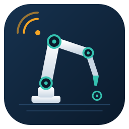

# Robot Arm Controller

โปรแกรมบนคอมพิวเตอร์ (Electron) สำหรับสั่งงานแขนกล 6 แกนในโหมด Arduino ผ่าน USB Serial
มีหน้าจอควบคุมแต่ละแกน ภาพ 3 มิติ Program Studio และ Analytics

วิธีติดตั้งและใช้งานอยู่ใน [README หลัก](../README.md) หัวข้อ "การติดตั้ง → 4) โปรแกรม Robot Arm Controller"

| ไฟล์ | หน้าที่ |
|---|---|
| `index.html` | หน้าจอและลอจิกทั้งหมด (Web Serial, ภาพ 3 มิติ, Program Studio, Analytics) |
| `main.js` | สร้างหน้าต่าง Electron และส่งรายชื่อพอร์ต Serial ให้หน้าจอเลือก |
| `meshes/` | ไฟล์ STL ของแขนกล AR2 จาก [Annin Robotics](https://anninrobotics.com/) (ใช้เพื่อการศึกษา ไม่ใช่เชิงพาณิชย์) |
| `build/icon.ico` | ไอคอนโปรแกรมที่ electron-builder ใช้ตอน `npm run build` |
| `RobotControlAPP.bat` | ดับเบิลคลิกเพื่อเปิดโปรแกรม (เหมือน `npm start`) |
